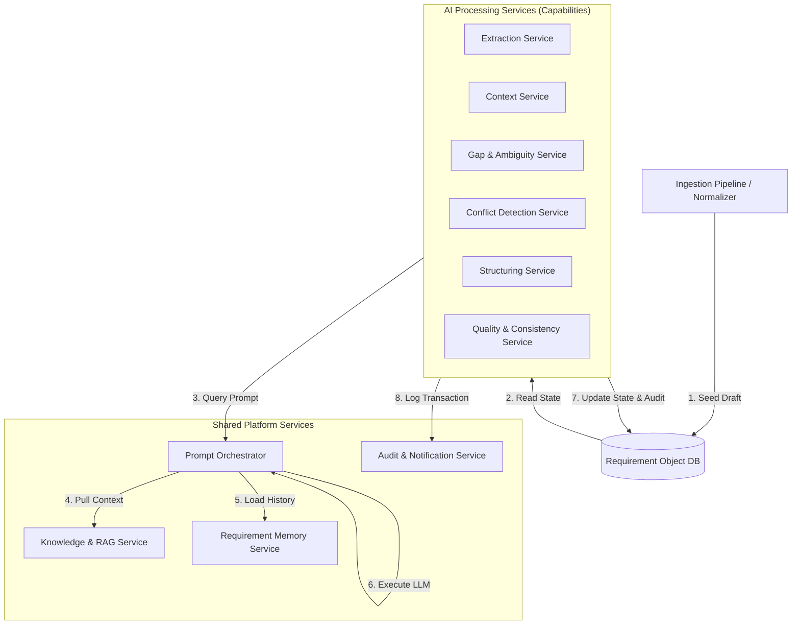

# AI Requirement Engineering Assistant (AREA)
## Product Design Specification (PDS)
### Volume 2 — AI Architecture

---

## Chapter 7: The Requirement Object Schema

### 7.1 Business Purpose
To prevent data fragmentation and conflicts, the platform must have a single source of truth. The **Requirement Object** acts as this central repository, capturing the requirement's content, versions, metadata, and history. It is updated by AI capabilities and reviewed by human stakeholders, keeping all details in one place.

### 7.2 Design Decisions
* **JSON Schema Document:** The Requirement Object is modeled as a structured JSON document. In the database, it is stored in a PostgreSQL `JSONB` column to allow fast querying, indexing, and schema flexibility as capabilities enrich it.
* **Granular Sub-Structures:** The object separates user stories, business rules, constraints, and histories into distinct arrays. This lets capabilities read or modify specific sections without rewriting the entire requirement.
* **Traceability & Relationship Graphing:** We extend the schema to support standard dependency tracking (`depends_on`, `blocked_by`, `duplicate_of`, `related_requirements`) and link the requirement object directly to generated downstream artifacts.

### 7.3 Component Responsibilities
The schema is responsible for tracking:
* **Identification & Project Tags:** Unique UUID, project tag, and domain context.
* **Lifecycle State & Ownership:** Current state (e.g., `BA_REVIEW`) and the assigned owner.
* **Requirement Content:** Epics, User Stories, Gherkin Acceptance Criteria, Business Rules, Constraints, and Assumptions.
* **Relationship Graph:** Traceability mappings pointing to other Requirement Object UUIDs.
* **Artifact References:** UUIDs of compiled documents and external Jira issue strings.
* **Traceability:** Links to source document UUIDs and paragraph indexes.
* **Audit & Version History:** Major/minor versions, change logs, and rationale.
* **Evaluations:** Confidence metrics, health scores, and string-based Health Labels.

### 7.4 Inputs and Outputs
* **Inputs:** JSON mutations submitted by AI Processing Services, or direct updates from the BA Workspace.
* **Outputs:** Validated JSON representation sent to user workspaces, export parsers, and template engines.

### 7.5 Implementation Notes (Pydantic Schema)
The Python backend defines the Requirement Object using Pydantic:

```python
from pydantic import BaseModel, Field
from typing import List, Dict, Optional
from uuid import UUID
from datetime import datetime

class RequirementContent(BaseModel):
    epic_title: str
    user_stories: List[Dict[str, str]] = Field(default_factory=list) # {"id": "US-1", "as_a": "", "i_want": "", "so_that": ""}
    acceptance_criteria: List[Dict[str, str]] = Field(default_factory=list) # {"id": "AC-1", "story_id": "US-1", "scenario": "", "given": "", "when": "", "then": ""}
    business_rules: List[Dict[str, str]] = Field(default_factory=list) # {"id": "BR-1", "statement": ""}
    constraints: List[Dict[str, str]] = Field(default_factory=list) # {"id": "CO-1", "statement": ""}
    assumptions: List[Dict[str, str]] = Field(default_factory=list) # {"id": "AS-1", "statement": ""}

class RequirementRelationships(BaseModel):
    depends_on: List[UUID] = Field(default_factory=list)
    blocked_by: List[UUID] = Field(default_factory=list)
    duplicate_of: Optional[UUID] = None
    related_requirements: List[UUID] = Field(default_factory=list)

class GeneratedArtifactReferences(BaseModel):
    brd_uuid: Optional[UUID] = None
    frd_uuid: Optional[UUID] = None
    rtm_uuid: Optional[UUID] = None
    test_case_uuids: List[UUID] = Field(default_factory=list)
    jira_epic_id: Optional[str] = None
    jira_story_ids: Dict[str, str] = Field(default_factory=dict) # {"US-1": "PROJ-101", "US-2": "PROJ-102"}

class RequirementObject(BaseModel):
    id: UUID
    project_id: UUID
    title: str
    current_state: str = "DRAFT"
    assigned_owner_role: str = "BUSINESS_ANALYST"
    content: RequirementContent
    relationships: RequirementRelationships = Field(default_factory=RequirementRelationships)
    artifacts: GeneratedArtifactReferences = Field(default_factory=GeneratedArtifactReferences)
    confidence_score: float = 0.0 # Normalized 0.0 to 100.0
    confidence_breakdown: Dict[str, float] = Field(default_factory=dict)
    health_score: float = 100.0 # 0.0 to 100.0
    health_status: str = "Healthy" # "Healthy", "Needs Review", "At Risk", "Blocked"
    open_questions_count: int = 0
    clarification_cycle_count: int = 0
    versions: List[Dict] = Field(default_factory=list) # Version history log
    audit_trail_ids: List[UUID] = Field(default_factory=list)
```

---

## Chapter 8: Document Ingestion Pipeline

### 8.1 Business Purpose
Requirements come from many document types. The **Document Ingestion Pipeline** extracts raw text and converts it into a normalized format. This decouples file parsing from downstream AI analysis, making it easy to add new document types in the future.

### 8.2 Design Decisions
* **Decoupled Extraction Layer:** Files are parsed to plain text using standard libraries (e.g., `PyPDF2` for PDFs, `python-docx` for Word documents). High-fidelity OCR and audio transcripts are out of scope for the MVP but can be added later by extending this extraction interface.
* **Immutable Document Repository:** Raw files and their normalized text are saved in an immutable repository with UUID keys. This ensures the source text remains unchanged for traceability queries.

### 8.3 Component Responsibilities
* **File Parser Service:** Reads file extensions (`.pdf`, `.docx`, `.xlsx`, `.eml`, `.txt`) and calls the correct extraction library.
* **Normalizer Service:** Strips special characters, formats whitespace, attaches metadata, and tags headers.
* **Document Repository:** Stores the file metadata and normalized text in PostgreSQL.

### 8.4 Inputs and Outputs
* **Inputs:** Raw binary files, filenames, file sizes, and project context.
* **Outputs:** 
  ```json
  {
    "document_uuid": "doc-99b28a...",
    "normalized_text": "Customer registration requirements...",
    "metadata": { "filename": "meeting_notes.docx", "word_count": 850 }
  }
  ```

### 8.5 Implementation Notes
The ingestion router is implemented as a factory class:

```python
class DocumentParserInterface:
    def extract_text(self, file_content: bytes) -> str:
        pass

class DocxParser(DocumentParserInterface):
    def extract_text(self, file_content: bytes) -> str:
        # Implementation using docx.Document
        ...

class PDFParser(DocumentParserInterface):
    def extract_text(self, file_content: bytes) -> str:
        # Implementation using PyPDF2
        ...
```

---

## Chapter 9: Shared Platform Services

### 9.1 Business Purpose
To keep our AI code clean and maintainable, we group shared functionalities—managing prompt templates, querying historical project memory, looking up guidelines via RAG, and auditing edits—into four central **Platform Services**.

### 9.2 Design Decisions
* **Stateless Capabilities + Stateful Services:** All AI Capabilities remain stateless. They query these four services to get context, look up memory, and log audit history.
* **Text Diff Storage:** The Memory Service uses standard JSON diff format to record updates. This keeps the database size small and allows BAs to compare requirement versions.

### 9.3 Component Responsibilities

#### 9.3.1 Requirement Memory Service
* **Description:** The system memory. It tracks requirement changes, version history, clarification history, and stakeholder comments.
* **Responsibility:** Calculates differences between versions and stores the change rationale (e.g., *"updated coupon rules as requested by PO in meeting 3"*).

#### 9.3.2 Prompt Orchestration Service
* **Description:** Standardizes prompt rendering and execution.
* **Responsibility:** Injects the current requirement data, historical memories, and RAG context into the template, runs the LLM, and logs token usage.

#### 9.3.3 Knowledge & RAG Service
* **Description:** The system's reference library.
* **Responsibility:** Indexes company standards, templates, glossaries, and policies in a vector store. It returns relevant context fragments to the prompt orchestrator.

#### 9.3.4 Audit & Notification Service
* **Description:** Logs events and sends notifications.
* **Responsibility:** Writes immutable audit entries to the database and alerts stakeholders (via email or workspace UI) when action is required.

### 9.4 Inputs and Outputs
* **Memory Service Inputs:** Draft and updated Requirement Objects. **Outputs:** JSON Diffs and change history maps.
* **Prompt Orchestration Inputs:** Template IDs and context variables. **Outputs:** Clean LLM responses.
* **RAG Service Inputs:** Query text. **Outputs:** Top-k similar text chunks from the vector store.
* **Audit Inputs:** Event type, user ID, timestamp, and metadata. **Outputs:** Immutable audit logs in the DB.

### 9.5 Implementation Notes
For the MVP, RAG uses ChromaDB with a lightweight local embedding model. Notifications are managed via a database queue, displaying in the dashboard UI with SMTP email fallbacks.

---

## Chapter 10: AI Processing Services (AI Capabilities)

### 10.1 Business Purpose
These services perform the core requirement analysis tasks. Each service focuses on a single analysis goal, turning unstructured text into structured, high-quality requirements.

### 10.2 Interaction Model
Below is the architectural diagram showing how AI Processing Services interact with the shared Platform Services before updating the centralized Requirement Object database:



### 10.3 Component Responsibilities & Fail-Safe Policies

#### 10.3.1 Extraction Service
* **Description:** Parses Normalized Documents to extract features, rules, constraints, and actors.
* **Success Condition:** At least one valid entity (Actor, Feature, or Business Rule) is successfully identified and parsed.
* **Failure Condition:** No text could be parsed, or the LLM returns an empty entity model.
* **Retry Strategy:** Trigger 1 automatic retry with an updated prompt temperature of $0.0$.
* **Escalation Behavior:** Fail the pipeline, flag the Document status as "Failed Extraction", and create an alert in the BA workspace requesting a manually seeded draft.

#### 10.3.2 Context Service
* **Description:** Maps dependencies between features and links them to business goals.
* **Success Condition:** Resolves references and populates the relationship graph matrices without syntax discrepancies.
* **Failure Condition:** Graph parsing errors, cyclic dependency loop detected (e.g., $A \rightarrow B \rightarrow A$).
* **Retry Strategy:** Retry once with an explicit list of detected cycles, instructing the LLM to prune secondary paths.
* **Escalation Behavior:** Log a Warning. Populate relationships as disconnected nodes, flag the requirement as "Needs Review," and mark the anomaly in the BA Dashboard.

#### 10.3.3 Gap Detection Service
* **Description:** Identifies missing details and generates clarification questions.
* **Success Condition:** Successfully checks all entities against the domain checklist and records generated questions (if any gaps exist) or registers 100% completeness.
* **Failure Condition:** LLM timeout or structured JSON response format schema violation.
* **Retry Strategy:** Max 2 retries. On second retry, fall back to a simpler gap checklist prompt (fewer domain dimensions).
* **Escalation Behavior:** Proceed with zero questions generated, log a RAG lookup exception, and flag the score as "Temporary/Unverified."

#### 10.3.4 Conflict Detection Service
* **Description:** Flags logical contradictions across different source documents.
* **Success Condition:** Completes cross-document semantic comparisons and logs resolved/unresolved conflict items.
* **Failure Condition:** Context window limit exceeded during cross-document comparisons.
* **Retry Strategy:** Break down comparison payload into pairwise document maps and execute comparisons sequentially.
* **Escalation Behavior:** Flag the requirement as `Needs Review`, log the comparison trace, and prompt the BA to resolve the document discrepancy manually.

#### 10.3.5 Requirement Structuring Service
* **Description:** Converts validated requirement data into structured User Stories and Gherkin Acceptance Criteria.
* **Success Condition:** Outputs well-formed stories and syntax-valid Gherkin scenarios for every feature.
* **Failure Condition:** Truncated story strings, missing scenarios, or invalid Gherkin syntax (e.g., `Given` statement without a corresponding `When` or `Then`).
* **Retry Strategy:** Trigger retry with the failed output highlighted, explicitly demanding Gherkin syntax compliance.
* **Escalation Behavior:** Save the raw extracted features as bullet points and notify the BA: *"AI was unable to format Gherkin scenarios automatically; manual formatting required."*

#### 10.3.6 Quality & Consistency Service
* **Description:** Checks requirements for syntax errors, clarity, and duplicates.
* **Success Condition:** Scans all structured text and returns verification flags (e.g., passive voice indicator, duplicate flags).
* **Failure Condition:** System validation schema execution error.
* **Retry Strategy:** Auto-retry once.
* **Escalation Behavior:** Set the confidence checks as uncalculated ("N/A") and let the requirement pass to the BA cockpit with a warning badge.

### 10.4 Inputs and Outputs
* **Inputs:** Read operations from the Requirement Object.
* **Outputs:** Enriched Requirement Object mutations.

### 10.5 Implementation Notes
All capabilities inherit from a base service model that handles connection pooling, prompt template resolving, token-budget limits, and exception logging to the centralized audit service.

---

## Chapter 11: Lifecycle Coordinator & Requirement State Machine

### 11.1 Business Purpose
Requirements must move through a structured approval process before they are ready for development. The **Lifecycle Coordinator** manages the state machine, tracks reviews, and routes clarification questions.

### 11.2 Design Decisions
* **State Gating:** State transitions are deterministic. A requirement cannot skip states. For example, it cannot transition from `DRAFT` to `APPROVED` without completing the `BA_REVIEW` and `PEER_REVIEW` stages.
* **Issue Routing by Category:** When a reviewer flags a requirement, the Coordinator routes the issue based on its category:
  * **Specification Quality (AI-Resolvable):** Routed to AI services (e.g., to generate missing acceptance criteria).
  * **Technical Feasibility:** Routed to the Developer Workspace.
  * **Business Decisions:** Routed to the BA and Client.
* **Clarification Loop Threshold:** To prevent infinite clarification cycles where the Client and AI keep exchanging questions and answers, we enforce a strict **Clarification Cycle Limit**.

### 11.3 Component Responsibilities
* **State Machine:** Enforces valid state transitions and updates ownership roles.
* **Task Router:** Creates clarification alerts in the workspaces of the assigned stakeholders.
* **Clarification Gatekeeper:** Enforces the loop threshold policies.

#### State Machine Transition Gate Matrix

| Source State | Triggering Event | Target State | Assigned Owner | Action Taken |
| :--- | :--- | :--- | :--- | :--- |
| `DRAFT` | Document validation completes. | `AI_ANALYZED` | System | AI Processing pipeline analyzes requirements. |
| `AI_ANALYZED` | AI capabilities finish analysis. | `BA_REVIEW` | BA | BA reviews drafts and confidence scores. |
| `BA_REVIEW` | BA approves clarification questions. | `CLARIFYING` | Client/Dev/QA | Stakeholders answer clarification questions. |
| `CLARIFYING` | Stakeholders submit answers. | `BA_REVIEW` | BA | AI updates requirement; BA reviews response. |
| `BA_REVIEW` | BA approves draft requirement. | `PEER_REVIEW` | Dev, QA, PO | Peer review checklist evaluates feasibility. |
| `PEER_REVIEW` | Feasibility or testability issue raised. | `BA_REVIEW` | BA | BA reviews feedback and coordinates changes. |
| `PEER_REVIEW` | All reviewer sign-offs received. | `FROZEN` | System | Requirement is locked; version is baselined. |

#### Clarification Cycle Limit & Loop Gating
* **Maximum Clarification Cycles:** Set to **3 cycles** for the MVP.
* **Gating Execution Rule:** Each time a requirement shifts from `BA_REVIEW` $\rightarrow$ `CLARIFYING` $\rightarrow$ `BA_REVIEW` after gathering answers, the `clarification_cycle_count` property is incremented by 1.
* **Escalation Rule:** If `clarification_cycle_count` reaches 3 and there are still unresolved gaps:
  * The state machine freezes auto-routing to the client.
  * The state shifts to `BA_REVIEW` with an owner assignment to the BA.
  * An escalation alert is raised on the BA Dashboard: *"Maximum clarification threshold reached for [Requirement Title]. Mandating face-to-face review or manual BA intervention to resolve remaining gaps."*

### 11.4 Inputs and Outputs
* **Inputs:** Trigger events (e.g., `APPROVE_DRAFT`, `SUBMIT_COMMENT`, `VOTE_REJECT`).
* **Outputs:** Updated state in the Requirement Object, new owner role, and audit logs.

### 11.5 Implementation Notes
The state controller validates transition conditions inside a SQL transaction block. This prevents concurrent update calls from putting the state machine into invalid intermediate states.

---

## Chapter 12: Human-in-the-Loop (HITL) Review Workflow

### 12.1 Business Purpose
To ensure requirements are accurate, human experts must review the AI's outputs. The **HITL Review Workflow** provides simple workspaces where stakeholders review requirements and sign off.

### 12.2 Design Decisions
* **Micro-Actions:** Workspace views are kept simple. Non-BA reviewers cannot edit text fields directly; they only submit comments, flag issues, or approve checklist options.
* **Annotation Model:** Feedback is saved as inline annotations linked to specific user stories or criteria IDs. This keeps comments contextualized.

### 12.3 Component Responsibilities
* **Annotation Manager:** Binds reviewer comments and risk ratings to specific Requirement Object elements.
* **Workspace View Renderer:** Restricts UI controls based on the logged-in role.
* **Approve/Reject Gatekeeper:** Enforces review conditions before notifying the Lifecycle Coordinator.

### 12.4 Inputs and Outputs
* **Inputs:** Comment texts, feasibility votes, risk annotations, and priority selections.
* **Outputs:** Enriched Requirement Object annotations and approval records.

### 12.5 Implementation Notes
For the MVP, workspaces are rendered using a React SPA. The app uses a global role-context selector to simulate workspace shifts between the BA, Client, Developer, and QA views without requiring a complex auth server.

---

## Chapter 13: Confidence & Health Score Engines

### 13.1 Business Purpose
BAs need simple metrics to understand requirement quality. The **Confidence Engine** evaluates the structural accuracy of requirements, while the **Health Engine** tracks workflow blocks and review delays.

### 13.2 Design Decisions
* **Strict Score Normalization:** Both confidence and health scores are mathematically normalized to guarantee values strictly between **0.0 and 100.0**.
* **Health Status Label Mapping:** To make metrics easily readable on dashboards, the health score is mapped to a discrete status label.

### 13.3 Component Responsibilities
* **Confidence Engine:** Calculates completeness, clarity, consistency, testability, and traceability.
* **Health Engine:** Calculates process health and maps the numeric score to the corresponding `health_status` label.

### 13.4 Inputs and Outputs
* **Inputs:** Current Requirement Object state, validation logs, open questions count, and cycle counters.
* **Outputs:** Normalised float scores and status labels.

### 13.5 Implementation Notes (Scoring Formulas & Label Mapping)

#### Normalized Confidence Score Formula
The score is computed using weighted metrics, each calculated out of 100:

$$\text{Confidence} = (w_1 \times \text{Completeness}) + (w_2 \times \text{Clarity}) + (w_3 \times \text{Consistency}) + (w_4 \times \text{Testability}) + (w_5 \times \text{Traceability})$$

* **Weights:** $w_1 = 0.30$ (Completeness), $w_2 = 0.20$ (Clarity), $w_3 = 0.20$ (Consistency), $w_4 = 0.15$ (Testability), $w_5 = 0.15$ (Traceability).
* **Normalization Gate:** The sum of weights equals 1.0. Each metric is capped at 100.0 and floored at 0.0, ensuring the final output is bound to $[0, 100]$.

#### Normalized Health Score & Status Mapping
The health score starts at 100.0 and is reduced based on workflow activities, with a minimum floor of 0.0:

$$\text{Health} = \max\left(0.0, \ 100.0 - (5.0 \times Q_{\text{open}}) - (10.0 \times R_{\text{rejections}}) - P_{\text{delay}}\right)$$

* $Q_{\text{open}}$: Number of open clarification questions.
* $R_{\text{rejections}}$: Cumulative review rejections across QA & Dev.
* $P_{\text{delay}}$: Penalty if the requirement remains in `PEER_REVIEW` for over 48 hours ($P_{\text{delay}} = 15.0$).

The numeric score is mapped to the corresponding `health_status` label:

* **Score Range $[90.0, 100.0]$:** `health_status = "Healthy"`
* **Score Range $[70.0, 89.9]$:** `health_status = "Needs Review"`
* **Score Range $[50.0, 69.9]$:** `health_status = "At Risk"`
* **Score Range $[0.0, 49.9]$:** `health_status = "Blocked"`

---

## Chapter 14: System Error Handling Strategy

### 14.1 Business Purpose
To ensure system stability, developers need clear guidelines on how to handle failures. This chapter defines our error handling, recovery, and fallback strategies for the core pipeline steps.

### 14.2 Design Decisions
* **Graceful Degradation:** When non-critical services (like RAG or notifications) fail, the system degrades performance instead of halting the workflow.
* **Deterministic Fail-Safe Gates:** Critical service failures (like text parsing or database write errors) automatically halt the workflow to protect data integrity.

### 14.3 Component Failures & Fallback Behaviors

#### 14.3.1 Parser Failures
* **Failure Scenario:** File ingestion encounters a password-protected, encrypted, or highly corrupted document.
* **System Action:** Ingestion halts. The system writes a warning to the log and returns a clean API error: `422 Unprocessable Entity`.
* **Fallback Behavior:** The document status is marked as "Failed Validation". An in-app alert prompts the BA to upload a plain-text version (`.txt`) of the file.

#### 14.3.2 LLM Service Downtime / Failures
* **Failure Scenario:** The LLM API returns rate limit errors (HTTP 429), server errors (HTTP 500), or times out.
* **System Action:** The Prompt Orchestrator catches the connection error.
* **Fallback Behavior:** 
  * Enforces an **Exponential Backoff Retry** policy: Max 3 retries (delays: 2s, 4s, 8s).
  * If all retries fail, it halts the pipeline, logs a `CRITICAL_LLM_DOWNTIME` error, restores the last active database state, and flags the dashboard: *"LLM connection lost. Analysis paused, changes saved safely."*

#### 14.3.3 RAG Knowledge Misses
* **Failure Scenario:** The Vector Database is unreachable, or semantic search returns zero matching document fragments.
* **System Action:** The search query logs a warning but does not halt execution.
* **Fallback Behavior:** The Prompt Orchestrator proceeds using standard default templates without organizational extensions. The Confidence Engine is notified, reducing the Traceability sub-score by 10 points.

#### 14.3.4 Notification Service Failures
* **Failure Scenario:** SMTP connection fails or Slack/Teams webhook calls time out.
* **System Action:** Logs the dispatch failure.
* **Fallback Behavior:** Alerts are added to the in-app database queue, ensuring the task appears in the stakeholder's dashboard when they log in. The system retries external delivery every 4 hours.

#### 14.3.5 Database Transaction Crashes
* **Failure Scenario:** Transaction conflicts or database connection pool timeouts.
* **System Action:** The backend rolls back the transaction.
* **Fallback Behavior:** Rollback ensures that the Requirement Object does not save partial data. The user receives a message: *"Server busy, failed to save requirement change. Please try again."*
