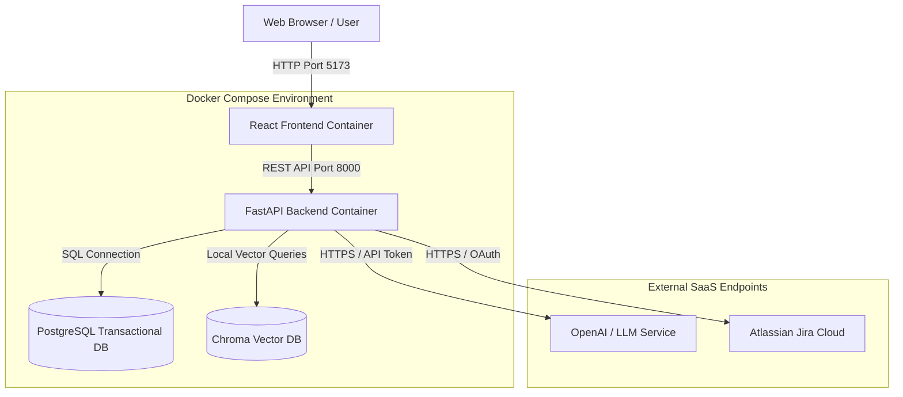

# Product Design Specification (PDS) Walkthrough
## AI-Driven Requirement Engineering Assistant (AREA)

This document indexes and summarizes the completed Product Design Specification (PDS) for the **AI-Driven Requirement Engineering Assistant (AREA)**. The architecture has been refined, validated, and frozen into four implementation-ready volumes.

## Deliverables Checklist

- `[x]` **Volume 1: Business & SDLC Design**
  - Vision, context (XYZ Retail E-commerce expansion), stakeholder workspaces, comparison of workflows, business KPIs, project assumptions, constraints, and risks.
  - File: [pds_volume_1_business_sdlc.md](file:///C:/Users/Admin/.gemini/antigravity/brain/2f4076ed-f314-4f69-9966-afb41b800105/pds_volume_1_business_sdlc.md)
- `[x]` **Volume 2: AI Architecture**
  - Requirement Object JSON schema (Pydantic), ingestion pipeline steps, platform services (Memory, Prompt Orch, RAG, Audit), stateless AI capabilities, state transitions gating matrix, loop-gating cycle threshold policies, and a system error handling strategy.
  - File: [pds_volume_2_ai_architecture.md](file:///C:/Users/Admin/.gemini/antigravity/brain/2f4076ed-f314-4f69-9966-afb41b800105/pds_volume_2_ai_architecture.md)
- `[x]` **Volume 3: Technical Architecture**
  - React + Vite frontend folder structure, FastAPI backend workspace file layout, sequence diagram of asynchronous execution, linear runner order, 8-table database DDL schema, 15 detailed REST API specifications, and Docker-compose local deployment configurations.
  - File: [pds_volume_3_technical_architecture.md](file:///C:/Users/Admin/.gemini/antigravity/brain/2f4076ed-f314-4f69-9966-afb41b800105/pds_volume_3_technical_architecture.md)
- `[x]` **Volume 4: Engineering Guide**
  - Prompts templates (Extraction, Gaps, Structuring), capability runner sequence execution script, pytest testing suite example with mock LLM fixtures, and a 4-week implementation roadmap for the MVP.
  - File: [pds_volume_4_engineering_guide.md](file:///C:/Users/Admin/.gemini/antigravity/brain/2f4076ed-f314-4f69-9966-afb41b800105/pds_volume_4_engineering_guide.md)

---

## Architectural Interaction Map

The following Mermaid component diagram outlines how the entire system connects, showing browser interaction, local container networking, database access, and integration with OpenAI and Jira Cloud:

